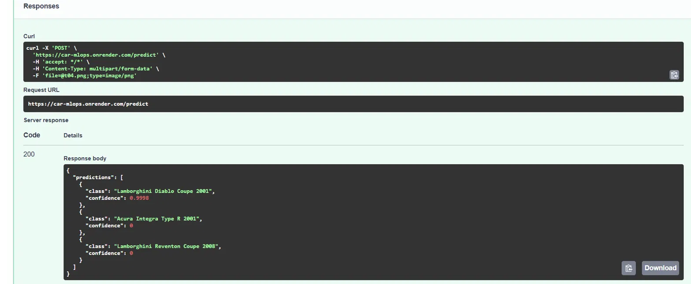
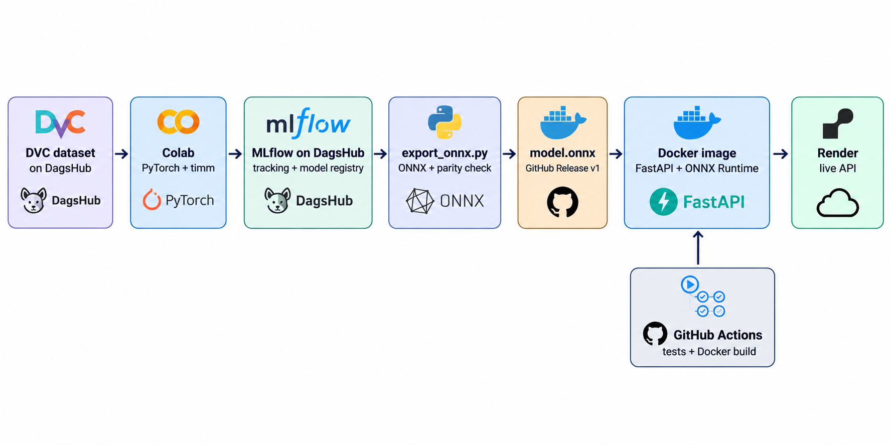

# Car Classifier MLOps: Stanford Cars, end to end

A ConvNeXt-Tiny image classifier for the 196 classes of the Stanford Cars dataset, with a full MLOps pipeline: experiment tracking, data versioning, model registry, ONNX export, CI, and a free cloud deployment.

**Live demo:** https://car-mlops.onrender.com/docs
Upload a car photo to `POST /predict` and get the top-3 make/model/year predictions.

> The service runs on Render's free tier and sleeps after about 15 minutes without traffic. The first request after a pause can take 30 to 60 seconds.



## Results

| Metric | Value |
|---|---|
| Top-1 accuracy, official test set (8,041 images) | **89.8%** |
| Best validation accuracy (1,222 images) | 91.6% |
| ONNX vs PyTorch, max absolute difference | 4.6e-06 (predictions identical) |
| ONNX model size | 112 MB |
| Latency per prediction, Render free tier (0.1 vCPU) | about 3.5 s (mean of 4 requests, range 2.0 to 4.9 s; measured in the browser, includes upload and network) |
| Memory | about 270 MB peak, about 230 MB steady, under a 512 MB limit (measured locally with `docker stats` on the same image; Render's free tier shows no metrics) |

The model was selected on validation accuracy and scored **once** on the test set.

## Architecture


## Training and experiments

All runs use ConvNeXt-Tiny, AdamW (lr 1e-4, weight decay 0.05), batch size 32, 10 epochs, cosine learning-rate schedule, strong augmentation (RandomResizedCrop, flip, TrivialAugmentWide, RandomErasing) and seed 42.

Data: the official Stanford Cars train split (8,144 images), split 85/15 with stratification by class into 6,922 train and 1,222 validation images. The official test split was kept untouched until the end.

| Run | Change | Best val acc |
|---|---|---|
| **C** (deployed) | baseline: strong aug + cosine | **91.6%** |
| D | + label smoothing 0.1 | 91.0% |
| E | + drop path 0.1 | 89.6% |

Run C was selected on validation accuracy and evaluated once on the test set (89.8%). Extra regularization did not help within a 10-epoch budget. The differences between C and D are small and may fall within noise; each configuration was run with a single seed.

All runs are tracked in MLflow: [DagsHub experiments](https://dagshub.com/nour-abdessatar/car-mlops/experiments)

## API

| Endpoint | Description |
|---|---|
| `POST /predict` | Multipart form with a `file` field (image). Returns the top-3 classes with confidences. |
| `GET /health` | Liveness check. |
| `GET /docs` | Interactive Swagger UI. |

Example:

```bash
curl -X POST https://car-mlops.onrender.com/predict \
  -F "file=@car.png;type=image/png"
```

```json
{
  "predictions": [
    {"class": "Lamborghini Diablo Coupe 2001", "confidence": 0.9998},
    {"class": "Acura Integra Type R 2001", "confidence": 0.0},
    {"class": "Lamborghini Reventon Coupe 2008", "confidence": 0.0}
  ]
}
```

## Run locally

```bash
docker build -t car-api .
docker run -p 8000:8000 car-api
# open http://localhost:8000/docs
```

The Docker build downloads `model.onnx` from the GitHub Release `v1`, so no model file is stored in git.

To re-export the model from the registry (needs DagsHub credentials in `MLFLOW_TRACKING_USERNAME` and `MLFLOW_TRACKING_PASSWORD`, plus `torch`, `timm`, `mlflow`, `onnx` and `onnxruntime`):

```bash
python scripts/export_onnx.py
```

## Design decisions

**Serving with ONNX Runtime instead of PyTorch.** Render's free tier offers 512 MB of RAM. A PyTorch serving image about 2.7 GB in my first version and uses a lot of memory just to load. ONNX Runtime is a small inference-only engine, so the image stays light: the serving container peaks at about 270 MB, which fits under the limit with room to spare. Training stays in PyTorch; only inference uses ONNX. The export script verifies the exported model against the original (max absolute difference 4.6e-06, identical argmax).

**Separate training and serving dependencies.** `requirements-serve.txt` contains only what the API needs (FastAPI, ONNX Runtime, NumPy, Pillow). An earlier version still listed `timm` and `mlflow`, which pulled in PyTorch, CUDA libraries, pandas and scikit-learn. The build ran out of disk space on Render's builder while CI, which has more disk, still passed. Removing those two lines fixed it. Lesson: CI passing does not mean the production builder will accept the image.

**Model stored as a GitHub Release asset.** The 112 MB model is too large to commit comfortably, so the Dockerfile downloads it from release `v1` at build time. This keeps the repository small, and pins the deployed model to a versioned release.

**Data versioning with DVC.** The dataset is tracked as a single archive in DVC with DagsHub as the remote, and the data hash is logged as a tag on the MLflow run, so a model can be traced back to the exact data it was trained on.

## Limitations

- **Free-tier latency.** The 0.1 vCPU instance makes inference slow (about 3.5 s per prediction), and the service sleeps when idle. A paid instance would reduce both.
- **Generalization gap.** Training accuracy (96.4%) is about 7 points above test accuracy (89.8%), which is typical when fine-tuning on a small dataset.
- **Dataset scope.** The model knows only the 196 Stanford Cars classes (mostly US models up to 2012). It will return a confident wrong answer for cars outside that set.
- **Single seed.** Experiment comparisons use one seed, so small differences between runs are not conclusive.
- **Small latency sample.** The latency figure comes from 4 requests measured in a browser, so treat it as an order of magnitude, not a benchmark.
- **No monitoring yet.** There is no prediction logging or drift detection. A `/metrics` endpoint would be the next step.

## Repository layout

```
app/                    FastAPI application (ONNX Runtime inference)
scripts/export_onnx.py  Export the registry model to ONNX and verify parity
tests/                  API tests
Dockerfile              Serving image
requirements-serve.txt  Serving dependencies only
.github/workflows/      CI: tests and Docker build
```
